  <picture>
    <source media="(prefers-color-scheme: dark)" srcset="profile/header-dark.svg">
    <source media="(prefers-color-scheme: light)" srcset="profile/header-light.svg">
    
  </picture>

Why do programmers prefer dark mode? Because light attracts bugs.

<table width="100%">
  <tr>
    <td>
      <b>languages</b> 
      
      
      
      
    </td>
  </tr>
  <tr>
    <td>
      <b>frontend</b> 
      
      
      
      
    </td>
  </tr>
  <tr>
    <td>
      <b>backend / infra</b> 
      
      
      
      
      
      
    </td>
  </tr>
  <tr>
    <td>
      <b>design</b> 
      
      
      
      
      
    </td>
  </tr>
</table>

  <a href="https://github.com/fired?tab=repositories">
    <picture>
      <source media="(prefers-color-scheme: dark)" srcset="cards/languages-dark.svg">
      
    </picture>
  </a>

<!-- The header and cards are regenerated nightly by .github/workflows/profile.yml. -->
